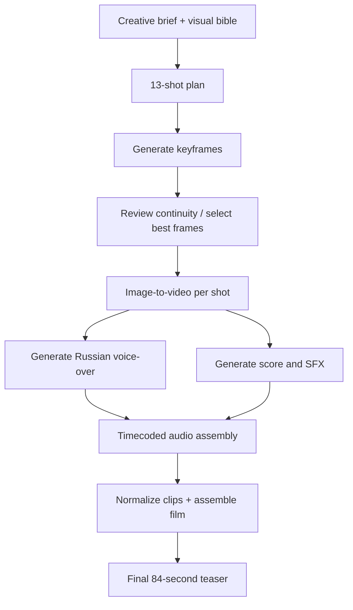

# IRON PULSE — ComfyUI Blockbuster Production Pipeline

> **Открывай в ComfyUI прежде всего:** `IRON_PULSE_BLOCKBUSTER_MASTER_WORKFLOW.json` в корне проекта. Это единый UI canvas со сценами, промптами и визуальной последовательностью. Model selection остаётся ручным. См. `workflows/ui/README_RU.md`.


**Оригинальный кинематографичный AI-teaser:** реалистичный тюнингованный muscle car, механическое пробуждение, трансформация, портовая погоня, противник, гигантская индустриальная машина, закадровый голос, саунд-дизайн и финальная сборка.

Это не коллекция разрозненных промптов. Репозиторий демонстрирует production-подход к AI filmmaking: continuity bible → shot design → keyframes → image-to-video → voice-over / score / SFX → edit & mix.

## Что внутри

- `story/` — творческая библия, shot list и русская voice-over концепция.
- `data/shot_plan.json` — 13 сцен с image prompt, video prompt, камерой, continuity locks и отрицательным промптом.
- `data/audio_plan.json` — реплики диктора, музыка и 13 SFX-сцен.
- `workflows/api/01_keyframe_sdxl_api.json` — готовый baseline-граф ComfyUI для keyframes на core nodes.
- `orchestrator/` — асинхронный Python-контроллер локального ComfyUI API: preflight, workflow patching, upload image, queue, polling, download outputs.
- `scripts/` — инспектор API workflow, проверка проекта и финальный монтаж через FFmpeg.
- `docs/` — архитектура, запуск на Windows, prompt-engineering playbook.

## Важное разделение

**Проект не является custom node.** Его не нужно помещать в `ComfyUI/custom_nodes`. Сам репозиторий можно хранить в любом каталоге, например `E:\AI\IRON_PULSE_ComfyUI`. ComfyUI запускается отдельно; Python orchestrator обращается к нему через локальный HTTP API.

На твоём скриншоте уже есть `video_minimax_h3_i2v`. Поэтому видео-этап специально подготовлен под экспорт именно твоего workflow: это безопаснее, чем подменять твои установленные MiniMax H3 nodes случайным Wan/LTX-графом.

## Быстрый запуск

1. Распакуй архив в `E:\AI\IRON_PULSE_ComfyUI`.
2. Открой терминал в этой папке и запусти `install_windows.bat`.
3. В `workflows/api/01_keyframe_sdxl_api.json` укажи точное имя установленного SDXL checkpoint в node `4`, либо замени этот graph на экспорт workflow той image-модели, которую используешь.
4. Убедись, что ComfyUI запущен и доступен по `http://127.0.0.1:8188`. При другом адресе измени `.env`.
5. Запусти `run_doctor.bat`.
6. Для проверки без генерации: `run_dry_keyframes.bat`.
7. Для генерации 13 keyframes: `run_keyframes.bat`.
8. Экспортируй свой `video_minimax_h3_i2v` через **Workflow → Export (API)** в `workflows/api/video_i2v_api.json`, настрой bindings и включи `video.enabled: true`.
9. Экспортируй три workflow: TTS → `voiceover_tts_api.json`, music → `music_api.json`, SFX → `sfx_api.json`; настрой mappings и включи соответствующие stages.
10. Экспортируй TTS / music / SFX workflows по инструкции ниже; включи соответствующие stages и сгенерируй звук. Когда будут готовы все assets, установи FFmpeg и запусти `render_film.bat`.

Подробный пошаговый гайд: [`docs/SETUP_WINDOWS.md`](docs/SETUP_WINDOWS.md).

## Команды генерации

```powershell
python -m orchestrator.cli run --stage keyframes
python -m orchestrator.cli run --stage video
python -m orchestrator.cli run --stage voiceover
python -m orchestrator.cli run --stage music
python -m orchestrator.cli run --stage sfx
```

Для точечного прогона добавь `--shot S05` на video/keyframes или `--item VO_01` на voiceover/music/SFX.

## Workflow в UI

Открой `workflows/api/01_keyframe_sdxl_api.json` через File → Open / drag-and-drop. API JSON может открываться на canvas, но не хранит node positions. После того как разместишь узлы удобно, сохрани отдельную UI-копию обычным **Workflow → Save**.

Чтобы видеть workflows в панели библиотеки, можно скопировать UI-сохранённые `.json` в каталог `ComfyUI/user/default/workflows/IRON_PULSE/` (путь зависит от portable/desktop-инсталляции). Не копируй весь репозиторий в `custom_nodes`.

## Производственный порядок



## Базовые допущения

- Windows 10/11, локальный ComfyUI, Python 3.11+, FFmpeg.
- Локальный ComfyUI API: `http://127.0.0.1:8188`.
- Один GPU-job одновременно: безопасный default для RTX 4080 16 GB и тяжёлых video models.
- Модели, LoRA, VAE, text encoders и custom nodes не входят в архив. Ты подключаешь их самостоятельно.
- SDXL baseline требует checkpoint, совместимый с `CheckpointLoaderSimple`; стартовое разрешение keyframe — 1536×864. Для Flux/Qwen/Nano Banana/MiniMax и прочих архитектур экспортируй их собственный workflow API и укажи mappings.

## Импорт в существующий GitHub repository `comfiui_demo`

Если используешь уже созданный `https://github.com/raphsoundmix-ctrl/comfiui_demo`, второй репозиторий создавать не нужно. Склонируй его локально, распакуй архив и скопируй **содержимое** папки `IRON_PULSE_ComfyUI` в корень клона (не создавай дополнительную вложенную папку `IRON_PULSE_ComfyUI`). Удали старый одно-байтовый файл `new`, затем выполни `git add -A`, `git commit` и `git push origin main`.

Подробные PowerShell-команды находятся в [`docs/EXISTING_REPO_UPLOAD.md`](docs/EXISTING_REPO_UPLOAD.md). Не копируй проект в `ComfyUI/custom_nodes`.

## Техническая проверка

- `python -m orchestrator.cli validate` — локальная структура и mappings.
- `python -m orchestrator.cli doctor` — связь с ComfyUI, доступные node classes, workflow файлы.
- `python -m orchestrator.cli dry-run --stage keyframes --shot S01` — preview patching.
- `python -m orchestrator.cli run --stage keyframes` — очередь всех keyframes.

## Креативные и технические ограничения

- Не генерируй читаемые титры внутри кадра. Typography добавляется в edit.
- Не меняй форму машины, stripe placement, wheels, materials и proportions между сценами.
- Для video generation сначала утверждай keyframe, потом делай I2V. Не пытайся просить одну генерацию одновременно придумать дизайн машины, сцену, камеру и 8 секунд сложной трансформации.
- Для сцены трансформации делай несколько коротких отдельных кадров, если модель теряет topology.
- Финальный montage использует hard cuts. Для профессиональных переходов добавляй sound bridges, match cuts и ручные transition clips в NLE.

## Источники по интеграции ComfyUI

API workflow format: https://docs.comfy.org/development/api-development/workflow-api-format
Server HTTP/WebSocket routes: https://docs.comfy.org/development/comfyui-server/comms_routes
Official Wan 2.2 I2V template: https://github.com/Comfy-Org/workflow_templates/blob/main/blueprints/image_to_video_wan_2_2.json
Official ComfyUI Manager: https://github.com/Comfy-Org/ComfyUI-Manager

## Публикация в GitHub

Создай пустой repository на GitHub, затем из корня проекта выполни:

```powershell
.\publish_to_github.bat https://github.com/OWNER/REPOSITORY.git
```

Либо используй стандартные `git init`, `git add`, `git commit`, `git remote add`, `git push`. Generated media в `outputs/` и секреты `.env` исключены через `.gitignore`; исходные prompts, plans, workflows, docs и orchestrator попадут в репозиторий.

> **ComfyUI Canvas first:** визуальные workflow-файлы находятся в `workflows/ui/`. Начни с `00_IRON_PULSE_MASTER_BOARD.json`. Это UI workflows с editable prompt nodes (`PrimitiveStringMultiline`), группами и последовательностью production. API workflow в `workflows/api/` — отдельный формат для оркестратора, не основной визуальный интерфейс.

